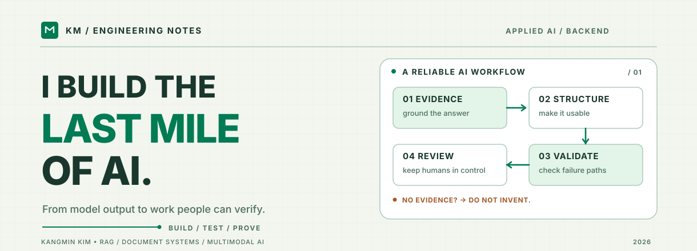

<picture>
  <source media="(prefers-color-scheme: dark)" srcset="./assets/identity-dark.svg" />
  <source media="(prefers-color-scheme: light)" srcset="./assets/identity-light.svg" />
  
</picture>

**김강민 · Kangmin Kim** 　`Applied AI` · `Backend Engineering` · `RAG / Document Intelligence`

[LinkedIn](https://www.linkedin.com/in/%EA%B0%95%EB%AF%BC-%EA%B9%80-015168396/)　 /　 [GitHub](https://github.com/kkm02113)　 /　 [Email](mailto:latrymos0@naver.com)

> **AI 결과가 얼마나 그럴듯한가보다, 그 결과를 실제로 사용할 수 있는가를 고민합니다.**  
> 검색 근거를 확인할 수 있는지, 출력 형식이 유지되는지, 실패했을 때 안전하게 멈추는지, 마지막 판단을 사람이 할 수 있는지가 중요합니다.

---

## 01 / My Focus

한림대학교 빅데이터전공에서 머신러닝과 소프트웨어를 공부하고, **LLM·검색·데이터·백엔드가 만나는 지점**에서 제품을 개발하고 있습니다.

| I care about | What it means in my work |
| :--- | :--- |
| **Grounded AI** | 검색 근거와 생성 결과를 연결하고, 근거가 부족할 때는 임의 생성을 막습니다. |
| **Reliable backend** | 정상 동작뿐 아니라 오류·동시성·재시도·출력 검증을 설계합니다. |
| **Useful output** | 모델의 응답을 문서, 리포트, 사용자 행동 같은 실제 결과물로 연결합니다. |
| **Learning from experiments** | 멀티모달 모델 실험과 평가로 AI 모델 자체에 대한 이해도 넓혀갑니다. |

## 02 / Selected Work

### CASE 01 — UniDocs AI
**대학 행정 문서의 ‘검색’과 ‘생성’을 연결하다.**  
`2026 – ongoing` · **My role: DocsGen / Backend**

학칙·규정·지침을 다루는 대학 행정 RAG 시스템에서 **문서 자동생성(DocsGen)** 기능을 담당합니다.

- **Problem** — 정확한 답변을 얻더라도 행정업무에는 원본 양식을 유지한 실제 문서가 필요합니다.
- **Built** — HWP/HWPX 템플릿의 표·병합 셀·필드 배치를 고려한 문서 생성과 `Draft → Review → Finalize` 검토 흐름을 구현했습니다.
- **Reliability** — 근거 부족 시 생성 방지, 출력 검증, 파일 처리 오류 및 회귀 테스트를 다룹니다.
- **Evidence** — 팀 최종 검증 기록 기준 집중 회귀 **240건**, 브라우저 **12/12**, 고정 양식 **19/20** 통과. 미해결 호환성 문제는 별도 관리했습니다.

`Python` `FastAPI` `PostgreSQL` `pgvector` `RAG` `HWPX`

### CASE 02 — [EROM-CARE](https://eromcare.kr)
**AI 상담을 한 번의 응답이 아닌 서비스 흐름으로 구현하다.**  
`2025` · **My role: Backend / AI Integration**

- **Problem** — 사용자에게 상담 응답만 제공하는 것으로는 실제 도움이 이어지기 어렵습니다.
- **Built** — 상담 API·데이터 모델·LLM 연동·상담사 매칭·리포트/대시보드 연결을 담당했습니다.
- **Evidence** — **2025 SW 캡스톤디자인 경진대회 대상(팀)**. 팀 프로젝트에서 RAG 데이터 9,648건을 활용했습니다.

`Next.js` `TypeScript` `PostgreSQL` `pgvector` `LLM`

### CASE 03 — [Samsung SCPC AI Challenge](https://github.com/kkm02113/SCPC-)
**서비스 개발을 넘어, 모델이 답을 고르는 과정도 실험하다.**  
`2025` · **Individual / Finalist**

- 이미지와 질문을 함께 처리하는 **Multimodal VQA** 과제에 참가해 본선에 진출했습니다.
- CLIP 기반 모델, 데이터 전처리, 학습·추론 파이프라인과 평가를 실험했습니다.

`Python` `PyTorch` `CLIP` `Multimodal Learning`

### CASE 04 — NightSAFE-SOMA
**의료데이터를 모델과 검색이 활용할 수 있는 형태로 만들다.**  
`2025` · **My role: Data Engineering / RAG**

- Snowflake SQL 기반 데이터 추출, Feature Engineering 및 RAG 연동 담당.
- 팀 분석 데이터 **25,427명 / 77,397건**.
- **제2회 H-iDEA 우수상(팀)**.

`SQL` `Snowflake` `Python` `RAG`

---

## 03 / Work in Progress

| Building | What I am actually working on |
| :--- | :--- |
| **[Seller Shield](https://github.com/kkm02113/seller-shield)** | 반품·클레임 대응 SaaS. 현재 PostgreSQL·Drizzle와 Better Auth 기반의 **DB/인증 저장 기반**을 구현·검증했습니다. 사용자 로그인, 사건 관리, AI 보조 기능은 아직 구현 전입니다. |
| **[Event Purchase Performance](https://github.com/kkm02113/event-purchase-performance)** | Java·Spring Boot·Redis·AWS·k6로 병목을 측정하고 캐시·로드밸런싱·서비스 분리의 효과를 비교하는 백엔드 아키텍처 실험. |

<details>
<summary><strong>Other explorations</strong></summary>

- **FoodFit / Demand Gate** — 프로토타입 백엔드·정보검색 개발 후 현장 인터뷰를 반영해 문제를 재정의했습니다.
- **Multilingual Meeting Agent** — 회의의 결정사항·담당자·기한을 구조화해 업무 도구로 연결하는 AI 에이전트 아이디어를 기획했습니다.

</details>

## 04 / Tools I Reach For

```text
AI / DATA         Python · PyTorch · RAG · Hybrid Retrieval · CLIP
APPLICATION       FastAPI · Next.js · TypeScript · REST API
STORAGE           PostgreSQL · pgvector · Redis · SQL
SYSTEMS           Docker · AWS · GitHub Actions · Testing · k6
```

> **My rule of thumb:** Model output is a draft. Evidence, validation and user control make it a product.

## 05 / Proof & Recognition

- **2025** — Samsung SCPC AI Challenge **본선 진출** (개인)
- **2025** — EROM-CARE **SW 캡스톤디자인 대상** (팀)
- **2025** — NightSAFE-SOMA **제2회 H-iDEA 우수상** (팀)
- **2025** — 제26회 강원 대학생 창업경진대회 **장려상** (팀)
- **2026** — NVIDIA DLI *Fundamentals of Deep Learning* 수료

---

<sub><strong>KM / ENGINEERING NOTES</strong> — 문제를 정의하고, 실패를 분리하고, 결과로 검증합니다.</sub>